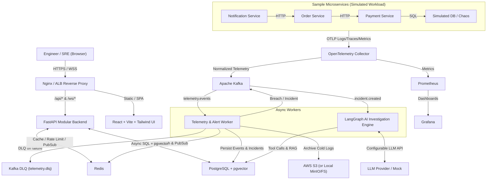
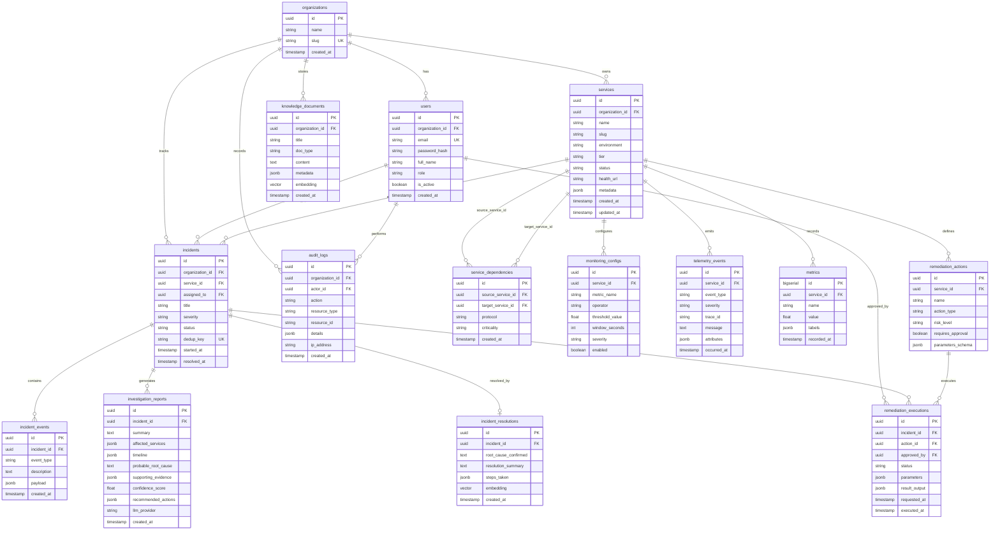
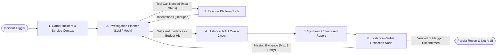
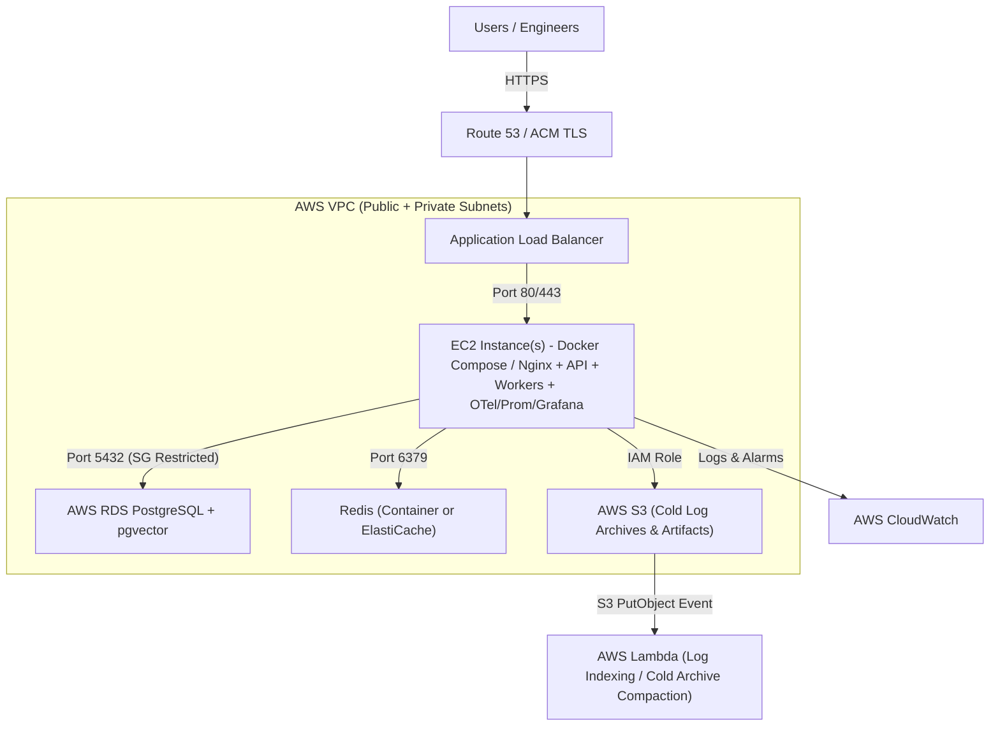

# NexusOps — Technical Blueprint

**Tagline:** *Understand incidents. Find root causes. Prevent failures.*

> [!NOTE]
> **Repository Inspection:** The workspace (`nexus-ops`) is currently empty. This blueprint establishes the complete architectural foundation, repository layout, and phased delivery plan before any code is written.

---

## 1. Detailed Product Requirements

NexusOps is an AI-powered cloud operations and incident intelligence platform designed for engineering and DevOps teams. It unifies infrastructure monitoring, centralized observability, interactive dependency mapping, evidence-based AI root-cause investigation, historical incident RAG, and human-approved remediation into a single cohesive system.

### Target Personas
- **Site Reliability Engineer (SRE) / On-Call Engineer:** Responds to alerts, investigates root causes across logs/metrics/traces, and executes safe remediations.
- **Backend / Platform Engineer:** Registers services, defines dependency topologies and alert thresholds, and reviews post-incident RCAs.
- **Engineering Manager / Admin:** Manages organization users, RBAC roles, audit logs, and remediation approval policies.

### Minimum Viable Product (MVP) vs. Future Enhancements

| Capability | MVP Scope (Phases 1–6 Core) | Future Enhancements (Post-MVP) |
| :--- | :--- | :--- |
| **Auth & Tenancy** | JWT auth, RBAC (`admin`, `operator`, `viewer`), single/multi-org isolation | SSO / OIDC (Okta, GitHub), fine-grained per-service ACLs |
| **Monitoring & Telemetry** | Simulated sample microservices + OTel/Prometheus/Grafana + synthetic fault injection | Real production agent onboarding, eBPF/cloud-native exporters |
| **Dependency Graph** | Explicitly registered + inferred service edges, React Flow interactive graph, blast-radius highlighting | Automated trace-derived topology discovery at scale |
| **Event Processing** | Kafka telemetry & incident topics, threshold evaluation, deduplication, DLQ, Redis caching, WebSocket live updates | Complex anomaly detection (EWMA / seasonality ML models) |
| **AI Investigation** | LangGraph agent with 7 real data-fetching tools, configurable LLM provider + deterministic mock mode, structured evidence-backed RCA | Multi-agent debate, automated runbook generation, Slack/PagerDuty bot |
| **Historical Intelligence** | PostgreSQL + `pgvector` semantic search over past incidents, RCAs, and runbooks | Cross-org anonymized pattern benchmarks, feedback loop scoring |
| **Remediation** | Predefined safe actions (restart simulated service, scale pool, toggle circuit breaker), mandatory human approval, audit log | Explicit AWS SSM / ECS / RDS / Lambda operational actions via IAM |
| **Deployment** | Docker Compose (local), AWS EC2 + RDS + S3 + Lambda via Terraform & GitHub Actions | AWS ECS Fargate migration, multi-AZ high availability |

---

## 2. Functional Requirements

1. **Authentication & RBAC (FR-1):** Users register/login via JWT (access + refresh tokens). Roles: `viewer` (read-only), `operator` (acknowledge/investigate incidents, request remediations), `admin` (manage services, thresholds, users, approve/execute high-risk remediations).
2. **Service Registry & Thresholds (FR-2):** CRUD for services (name, owner, environment, tier, health endpoint) and monitoring configs (CPU, memory, latency p95, HTTP 5xx rate thresholds, evaluation window).
3. **Centralized Observability (FR-3):** Collect structured logs, metrics, and distributed traces via OpenTelemetry Collector; scrape/store metrics in Prometheus; visualize dashboards in Grafana; query correlated logs/metrics/traces from NexusOps API.
4. **Dependency Mapping & Blast Radius (FR-4):** Define directed dependencies (`source_service -> target_service`, criticality, protocol). Render interactive React Flow graph showing health status and highlighting upstream/downstream failure propagation.
5. **Event-Driven Incident Lifecycle (FR-5):** Ingest telemetry into Kafka, evaluate thresholds asynchronously, deduplicate/correlate alerts into incidents (`open` -> `investigating` -> `mitigated` -> `resolved`), and push real-time updates over WebSockets.
6. **AI Incident Investigation (FR-6):** Trigger LangGraph investigation on an incident. The agent calls platform tools (health, logs, metrics, traces, dependencies, historical incidents, docs) and outputs a structured report with summary, timeline, probable root cause, supporting evidence, confidence score, and recommended actions.
7. **Historical Incident Knowledge Base (FR-7):** Embed resolved incidents, RCAs, and operational docs into `pgvector` for semantic similarity search during investigations and manual search.
8. **Controlled Remediation & Auditability (FR-8):** Engineers review AI-recommended or predefined remediation actions, approve/reject them, execute approved actions (simulated initially, optional AWS APIs later), and record immutable audit logs.

---

## 3. Non-Functional Requirements

| Category | Requirement |
| :--- | :--- |
| **Performance** | API p95 latency < 200 ms for cached/standard reads; WebSocket alert delivery < 2 s from threshold breach; `pgvector` HNSW/IVFFlat search < 100 ms. |
| **Reliability & Fault Tolerance** | Kafka consumer idempotency keys, exponential backoff retries, Dead-Letter Queue (`telemetry.dlq`) for poison messages, graceful degradation when LLM provider is unavailable (fallback/mock mode). |
| **Security** | Argon2/bcrypt password hashing, JWT with short expiry, Pydantic input validation, parameterized SQLAlchemy queries, Redis-backed API rate limiting, secrets via env/AWS Secrets Manager, zero autonomous infra mutations. |
| **Scalability** | Stateless FastAPI backend behind Nginx/ALB; horizontally scalable Kafka consumer workers via consumer groups; Redis caching for hot service-health reads; SQLAlchemy async connection pooling. |
| **Observability** | Structured JSON logging with `trace_id` correlation, `/health` and `/ready` probes, Prometheus `/metrics` endpoint on all Python services. |
| **Maintainability** | Modular monolith API + dedicated workers, Alembic DB migrations, Ruff + mypy/TypeScript strict checks, pytest + Vitest test suites, GitHub Actions CI. |

---

## 4. High-Level Architecture Diagram



---

## 5. Component-Level Architecture

We deliberately use a **Modular Monolith API + Dedicated Async Workers** pattern rather than splitting NexusOps itself into 10 tiny microservices.
- **Why:** Premature microservice decomposition adds network hops, distributed transaction headaches, and deployment overhead without solving a real scaling bottleneck. A modular FastAPI app with clear internal domain boundaries (`auth`, `services`, `observability`, `incidents`, `investigations`, `remediation`) keeps development fast and maintainable, while isolating heavy/async workloads (Kafka stream processing, LangGraph agent execution) into independently scalable worker processes.

### Core Components
1. **Frontend (`frontend/`):** React 18, TypeScript, Vite, Tailwind CSS, Recharts (time-series metrics), React Flow (interactive dependency graph), WebSocket client for live incident/health updates.
2. **Backend API (`backend/app/`):** FastAPI + Pydantic v2 + async SQLAlchemy 2.0. Exposes REST APIs (`/api/v1/...`), WebSocket hub (`/ws/live`), Prometheus `/metrics`, and health probes.
3. **Event Processing Worker (`backend/workers/telemetry_worker.py`):** Consumes `telemetry.events` from Kafka, normalizes payloads, updates Redis health cache, evaluates threshold rules, correlates/deduplicates incidents, and publishes `incident.created` / `ws.broadcast` events.
4. **AI Investigation Engine (`backend/app/ai/` + `backend/workers/ai_worker.py`):** LangGraph state machine invoked on demand or via `incident.created` events. Uses tool calling against internal repositories/clients (never raw hallucination) and persists structured `investigation_reports`.
5. **Observability Stack (`infra/observability/`):** OpenTelemetry Collector receives OTLP from sample microservices, exports metrics to Prometheus (visualized in Grafana) and forwards normalized telemetry events to Kafka/API.
6. **Data Layer:** PostgreSQL 16 + `pgvector` (primary relational store + vector embeddings), Redis 7 (service health cache, rate limiting, WebSocket pub/sub), Kafka (event backbone).

---

## 6. Microservices & Worker Responsibilities

### A. NexusOps Platform Services
| Service / Process | Responsibility | Scaling Strategy |
| :--- | :--- | :--- |
| `nexus-api` (FastAPI) | Auth/RBAC, CRUD, query APIs, WebSocket fan-out, remediation orchestration | Stateless horizontal replicas behind Nginx/ALB |
| `telemetry-worker` | Kafka consumer for `telemetry.events`, threshold evaluation, incident creation, DLQ routing | Kafka consumer group partitions |
| `ai-worker` | Executes LangGraph investigations asynchronously so HTTP requests never time out | Concurrent async worker pool |
| `otel-collector` | Receives OTLP logs/traces/metrics, batches and exports to Prometheus & Kafka | Collector pipeline |

### B. Sample Target Microservices (Simulated Production Workload)
To demonstrate realistic cascading failures without needing external production apps, NexusOps includes a lightweight **Sample E-Commerce Cluster** (`sample-services/`) with built-in chaos/fault injection endpoints:
- **`order-service`:** Calls `payment-service` to process orders. Fails with cascading 502/504s when `payment-service` degrades.
- **`payment-service`:** Simulates DB connection pool usage and payment processing. Supports chaos toggles (e.g., `POST /chaos/db-exhaustion`, `POST /chaos/latency-spike`, `POST /chaos/http-500`) to trigger realistic multi-service incidents.
- **`notification-service`:** Downstream consumer of `order-service` events; demonstrates blast-radius propagation (`Database <- Payment <- Order <- Notification`).

---

## 7. Database ER Diagram

Normalized PostgreSQL 16 schema with `pgvector` (`vector(1536)` or configurable embedding dimension).



### Key Indexing Strategy
- `telemetry_events`: Composite B-tree index `(service_id, occurred_at DESC)` and `(trace_id)`.
- `metrics`: Composite B-tree index `(service_id, name, recorded_at DESC)`.
- `incidents`: Partial/filtered index `(organization_id, status, started_at DESC)` and unique index on `dedup_key` (for active incident deduplication).
- `incident_resolutions` & `knowledge_documents`: `pgvector` HNSW index on `embedding` (`vector_cosine_ops`) for fast semantic retrieval.

---

## 8. AI Agent Architecture (LangGraph)

The AI Investigation Engine is built as a single, stateful **LangGraph** agent (avoiding unnecessary multi-agent swarm overhead) with bounded reasoning loops and strict evidence-grounding rules: **it never presents a hypothesis as a confirmed root cause without tool-retrieved evidence.**



### Agentic & Closed-Loop Engineering Design
1. **Bounded ReAct Tool-Calling Loop:** `AgentNode` ↔ `ToolNode` iterates dynamically until sufficient evidence is gathered, enforcing a strict **max-step budget** and **tool-call deduplication** so the agent cannot spin indefinitely.
2. **Evidence-Verifier Reflection Loop:** Before saving a report, `ValidateNode` checks that every claim in `probable_root_cause` cites actual tool observations from the run. If unsupported, it loops back once (`max_retries=1`) to gather missing telemetry or explicitly downgrades `confidence_score` and marks the cause as an unconfirmed hypothesis.
3. **Closed-Loop Operations & Knowledge Feedback (HITL):**
   - `Detect → Investigate → Human Approves Remediation → Execute → Verify Recovery → Learn`
   - After an engineer approves and executes a remediation, NexusOps runs a **post-remediation verification check** (monitoring health/metrics for a recovery window) to confirm the incident actually resolved (or re-open/escalate if not). Confirmed resolutions are embedded into `pgvector` (`incident_resolutions`) so future investigations improve continuously.

### Investigation Tools (7 Read-Only Platform Tools)
1. `get_service_health(service_id)`: Fetches current health, status, and recent threshold breaches from Redis/PostgreSQL.
2. `search_logs(service_id, severity, trace_id, window_minutes)`: Queries structured `telemetry_events` for errors and stack traces.
3. `fetch_metrics(service_id, metric_names, window_minutes)`: Queries CPU, memory, latency p95, error rate, and DB pool metrics.
4. `get_distributed_traces(trace_id | service_id)`: Retrieves correlated trace spans across upstream/downstream services.
5. `inspect_dependencies(service_id)`: Traverses `service_dependencies` upstream and downstream to map blast radius.
6. `search_historical_incidents(query_text, top_k)`: Performs `pgvector` cosine similarity search over `incident_resolutions`.
7. `search_operational_docs(query_text, top_k)`: Performs `pgvector` search over `knowledge_documents` (runbooks, architecture docs).

### Configurable LLM Provider & Offline Mode
- Abstracted behind an `LLMProvider` interface (`OpenAI`, `Anthropic`, `Gemini`, or `MockRuleBasedProvider`).
- When no API key is configured, `MockRuleBasedProvider` executes the exact same LangGraph tool-calling loop and synthesizes a deterministic, evidence-backed report from the actual tool outputs—ensuring the entire platform works out-of-the-box without external credentials.

---

## 9. Event Processing Workflow

```mermaid
sequenceDiagram
    participant Svc as Sample Microservices
    participant OTel as OTel Collector
    participant Kafka as Kafka (telemetry.events)
    participant Worker as Telemetry Worker
    participant Redis as Redis
    participant PG as PostgreSQL
    participant WS as WebSocket Hub

    Svc->>OTel: Emit OTLP logs, metrics, traces
    OTel->>Kafka: Publish normalized TelemetryEvent (with idempotency_key)
    Kafka->>Worker: Consume batch
    Worker->>Redis: Check idempotency_key (skip if duplicate)
    Worker->>PG: Batch insert telemetry_events & metrics
    Worker->>Redis: Update hot service health state (TTL 60s)
    Worker->>Worker: Evaluate monitoring_configs thresholds
    alt Threshold Breached
        Worker->>PG: Upsert incident by dedup_key (open)
        Worker->>Kafka: Publish incident.created
        Worker->>Redis: Publish to ws:updates channel
        Redis->>WS: Broadcast real-time alert to UI
    end
    Note over Worker,Kafka: Transient errors retry 3x with backoff; poison messages route to telemetry.dlq
```

### Distributed Systems Patterns Demonstrated
- **Idempotency:** Events carry an `idempotency_key`; Redis deduplicates replays.
- **Incident Deduplication:** Repeated threshold breaches for the same `(service_id, metric_name)` attach to the existing `open` incident via `dedup_key` instead of flooding engineers with 500 duplicate alerts.
- **Retry + Dead-Letter Queue (DLQ):** Failed message processing retries with exponential backoff; unrecoverable payloads go to `telemetry.dlq` for inspection.

---

## 10. AWS Deployment Architecture (No Kubernetes)

Designed for clean, cost-effective, production-style AWS deployment managed via **Terraform** and **GitHub Actions**, explicitly avoiding Kubernetes.



- **EC2:** Runs containerized application services (`nginx`, `frontend`, `nexus-api`, `telemetry-worker`, `ai-worker`, `kafka`, `redis`, `otel-collector`, `prometheus`, `grafana`) using Docker Compose.
- **RDS PostgreSQL:** Managed database with `pgvector` enabled in private subnet.
- **S3:** Stores archived cold telemetry logs and exported investigation reports.
- **AWS Lambda:** Triggered on S3 archive events or scheduled EventBridge rules for log compaction/retention cleanup.
- **IAM & Security:** EC2 instance profile with least-privilege S3/CloudWatch/Secrets Manager permissions; security groups restricting RDS to EC2 SG only.

---

## 11. Repository Folder Structure

```text
nexus-ops/
├── .github/
│   └── workflows/              # CI (lint, test, build) & CD (deploy to EC2)
├── backend/
│   ├── app/
│   │   ├── api/                # Versioned REST routers & WebSocket endpoints
│   │   ├── core/               # Config, security (JWT/RBAC), logging, rate-limit
│   │   ├── db/                 # SQLAlchemy engine, session pool, Alembic migrations
│   │   ├── models/             # ORM models (15 normalized tables)
│   │   ├── schemas/            # Pydantic v2 request/response schemas
│   │   ├── services/           # Business logic per domain
│   │   ├── ai/                 # LangGraph agent, tools, LLM provider abstraction, RAG
│   │   └── main.py             # FastAPI entrypoint
│   ├── workers/
│   │   ├── telemetry_worker.py # Kafka consumer, threshold engine, DLQ
│   │   └── ai_worker.py        # Async LangGraph investigation runner
│   ├── tests/                  # Unit & integration tests (pytest)
│   ├── Dockerfile
│   └── pyproject.toml
├── frontend/
│   ├── src/
│   │   ├── api/                # Typed API & WebSocket clients
│   │   ├── components/         # Reusable dark-theme UI primitives & charts
│   │   ├── pages/              # 10 SaaS pages (Overview, Services, Graph, Incidents, etc.)
│   │   ├── hooks/              # Auth, WebSocket, polling hooks
│   │   └── types/              # TypeScript interfaces
│   ├── Dockerfile
│   └── package.json
├── sample-services/            # Simulated microservices (order, payment, notification)
│   ├── order_service/
│   ├── payment_service/
│   └── notification_service/
├── infra/
│   ├── observability/          # OTel Collector, Prometheus, Grafana provisioning
│   ├── nginx/                  # Reverse proxy config
│   └── terraform/              # VPC, EC2, RDS, S3, Lambda, IAM, Security Groups
├── docs/                       # Architecture Decision Records (ADRs) & runbooks
├── docker-compose.yml          # Full local development stack
├── .env.example                # Environment variable template (no secrets)
└── README.md
```

---

## 12. Phase-Wise Implementation Plan

Each phase is broken into small, testable milestones. We will verify tests after every milestone before moving forward.

- **Phase 1: Foundation (MVP Core)**
  - Repo scaffolding, `.env.example`, Docker Compose (PostgreSQL + pgvector, Redis).
  - FastAPI core, SQLAlchemy async setup, Alembic migrations for core tables (`organizations`, `users`, `services`, `monitoring_configs`, `audit_logs`).
  - JWT auth + RBAC + Service Registry CRUD + unit/API tests.
  - React + Vite + Tailwind dark-theme shell, Login, Overview Dashboard, and Services page.
- **Phase 2: Monitoring & Observability**
  - Sample microservices (`order`, `payment`, `notification`) with health endpoints, chaos toggles, and OTel instrumentation.
  - OTel Collector + Prometheus + Grafana provisioning in Docker Compose.
  - Infrastructure Monitoring & Logs/Metrics query APIs + Recharts dashboards in React.
- **Phase 3: Event Processing & Incident Management**
  - Kafka + `telemetry-worker` with idempotency, threshold evaluation, incident deduplication, retries, and `telemetry.dlq`.
  - Redis health caching, rate limiting, and WebSocket real-time incident/health updates.
  - Incidents list & detail UI with live updates.
- **Phase 4: AI Incident Investigation**
  - Configurable `LLMProvider` (OpenAI/Gemini/Anthropic + `MockRuleBasedProvider`).
  - LangGraph bounded ReAct agent + 7 platform tools + tool-call deduplication.
  - Evidence-Verifier Reflection Loop (`ValidateNode` with max-1 retry & unconfirmed-hypothesis guardrail).
  - `ai-worker` + Incident Investigation & AI Operations Assistant UI.
- **Phase 5: Historical Intelligence & Dependency Mapping**
  - `pgvector` embeddings for `incident_resolutions` and `knowledge_documents` + RAG retrieval tools.
  - Historical Incidents page + semantic search.
  - `service_dependencies` API + interactive React Flow Dependency Graph with failure propagation & blast-radius highlighting.
- **Phase 6: Remediation, Cloud Deployment & Hardening**
  - Remediation Center (predefined safe actions, mandatory HITL approval, simulated execution, audit logs).
  - Closed-loop post-remediation health verification (auto-verify recovery or re-open/escalate) + automatic `pgvector` embedding of confirmed RCAs.
  - Terraform modules (VPC, EC2, RDS, S3, Lambda, IAM) + GitHub Actions CI/CD.
  - End-to-end integration tests, security review, and interview-ready architecture docs (ADRs).
